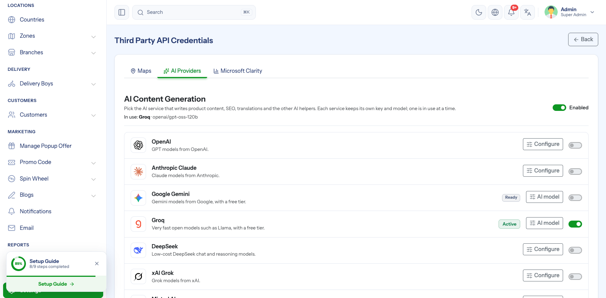
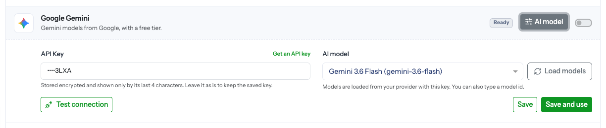

# AI Settings

Menu path: **Settings → Third-Party API Credentials → AI**

SnapBuy can write for you. Connect one AI service, pick a model, and the panel grows a **Generate with AI** or **Suggest with AI** button wherever text or setup work is repetitive — product descriptions, SEO, blog posts, translations, variants, notification copy and support chat replies.

:::info Entirely optional
With AI switched off — or never set up — every one of those buttons simply disappears and all those fields are filled by hand, exactly as before. Orders, payments, delivery and notifications do not use AI at all.
:::

## What AI does in the panel

| Feature | Where | What it produces |
| --- | --- | --- |
| **Product autofill** | Products → Add/Edit → *Product Details* | Short and long description, tags, manufacturer, country of origin and brand, from the product name |
| **Variant suggestions** | Products → Add/Edit → *Variants* | The attribute values this product should come in, plus the specifications that are the same for every variant |
| **Product recommendations** | Products → a product's recommendations | **Cross-sell** from what customers actually bought in the same orders; **upsell** from dearer products in the same category |
| **Category setup** | Categories → Add/Edit | Which of your attributes the category should use, attributes you do not have yet, and specification sections |
| **Descriptions** | Product form, Blogs | Rich-text content from a short prompt |
| **SEO** | Product *SEO* step, [SEO Settings](/docs/admin/seo-settings) | Meta title, keywords and description |
| **Translation** | Any translatable field | Fills your other languages from the one you typed |
| **Push notification copy** | [Send Notifications](/docs/admin/send-notifications) | Title and message |
| **Promo code copy** | Promo Codes | Promo name and description |
| **Template rewrite** | Email, SMS and [notification templates](/docs/admin/notification-templates) | Rewrites the template, keeping every `{placeholder}` intact |
| **Chat replies** | Chat | **Suggest a reply**, **improve my text** (same meaning, clearer wording) and **summarise this chat** |

:::warning AI suggests; you apply
Nothing is saved behind your back. Every suggestion lands in the form, or in a dialog where you tick what to keep, and you press Save. The one exception is attribute values you accept from a variant suggestion — those are created so the variants can use them.
:::

## Choosing a provider

The AI tab lists every service SnapBuy speaks to. **Google Gemini** uses its own API; everything else uses the OpenAI API format, which is why one list covers so many services.

| Provider | Get a key from |
| --- | --- |
| **OpenAI** | platform.openai.com/api-keys |
| **Anthropic Claude** | console.anthropic.com/settings/keys |
| **Google Gemini** | aistudio.google.com/apikey |
| **Groq** | console.groq.com/keys |
| **DeepSeek** | platform.deepseek.com/api_keys |
| **xAI Grok** | console.x.ai |
| **Mistral AI** | console.mistral.ai/api-keys |
| **OpenRouter** | openrouter.ai/keys |
| **Together AI** | api.together.ai/settings/api-keys |
| **Custom** | Any other OpenAI-compatible service — you supply the base URL |

Each row carries a link to that provider's key page, so you do not have to hunt for it.

:::tip Custom covers self-hosted models
Pick **Custom**, enter the base URL of any OpenAI-compatible endpoint — a local Ollama or LM Studio server, a company gateway, a provider not on the list — and the API key becomes optional, because a local model usually does not need one.
:::

## Setting one up

1. Open the provider's row.
2. Paste the **API key**. (**Custom** also needs a **Base URL**.)
3. Press **Load models** — SnapBuy asks the provider which models that key can use and fills the dropdown. You can also type a model id yourself.
4. Press **Test connection**. It sends one tiny prompt and tells you whether the key, the model and the network all work.
5. Press **Save**, or **Save and use** to make it the provider the panel uses.

| Control | What it does |
| --- | --- |
| **Master switch** (top right) | Turns AI off everywhere in the panel without deleting any key |
| **Provider switch** (each row) | Makes that provider the active one. Only one is used at a time. |
| **Ready** badge | That provider has a key and a model saved, so it can be switched to instantly |
| **Active** pill | The provider the panel is using right now |
| **Load models** | Fetches the model list using the key in the box, or the saved one if you have not retyped it |
| **Test connection** | One small live request — the quickest way to tell a wrong key from a wrong model |

:::info Every provider keeps its own key and model
Switching from OpenAI to Gemini and back does not lose anything: each row stores its own key, model and base URL. That makes it cheap to compare two providers on the same job.
:::

:::danger A provider cannot be activated until it is ready
"Ready" means a key (where the provider needs one) **and** a model. A row with a key but no model stays inactive, and the AI buttons will not appear.
:::

### Which model to pick

Any model the provider lists will work. The jobs SnapBuy asks for are short, so a fast, cheap model is usually the right choice — the "flash", "mini" or "small" tier of whichever provider you chose. Model names change often, which is why **Load models** reads the live list instead of SnapBuy shipping a fixed one.

## How your key is stored

| | |
| --- | --- |
| **Encrypted** | Keys are encrypted with your application key (`APP_KEY`) before they are written to the database |
| **Never shown again** | The panel only ever shows a mask — `••••` plus the last four characters |
| **Saving the mask keeps the key** | Leave the masked value alone and press Save; the stored key is untouched. Clear the field to remove the key. |

:::danger Changing APP_KEY loses every stored key
`APP_KEY` is what decrypts them. Change it — a fresh install, a copied `.env`, a careless `key:generate` — and SnapBuy reads "no key" rather than failing loudly. Re-enter the key on the AI tab afterwards. The same applies to payment and SMS credentials, so never regenerate `APP_KEY` on a live store.
:::

## Usage

Under the provider list, **AI usage, last 30 days** expands into one row per feature: calls, how many failed, and tokens used.

Use it to see which feature is actually costing you something before you pick a cheaper model, and to spot a feature failing repeatedly — a long run of failures on one feature usually means that model rejects the prompt, not that the key is wrong.

:::info You pay the provider directly
SnapBuy adds nothing to the price. Every call is billed by the AI provider against the key you entered, at that provider's own rate. See [Third-Party Service Costs](/docs/admin/third-party-costs#ai-content-generation).
:::

## Upgrading from the old Gemini key

Earlier versions had a single **Gemini Key** field on this page. Your key is carried over the first time the new settings are saved and shows as Gemini's key, so AI keeps working and nothing needs re-entering.

What changes is that you now pick a **model** as well. Gemini installs that never chose one keep running on the built-in default until you choose.

## Troubleshooting

| Symptom | Cause | Fix |
| --- | --- | --- |
| No AI buttons anywhere in the panel | The master switch is off, or no provider is ready | Turn AI on; give the active provider a key and a model |
| Provider shows no **Ready** badge | Key or model missing | Fill both, then Save |
| **Load models** returns an error | Wrong key, or the provider is unreachable from your server | Check the key; check the server can make outbound HTTPS calls |
| **Test connection** fails but the key is right | The model id does not exist for that key, or that key has no quota or billing | Pick a model from the loaded list; check your account at the provider |
| It worked yesterday, now every call fails | Provider quota or billing, or the key was revoked | Check the provider's dashboard; re-enter the key |
| Everything AI stopped after a migration | `APP_KEY` changed, so the stored key no longer decrypts | Re-enter the API key |
| Generated text is in the wrong language | AI writes in your panel's default language | Change the panel language, or translate the result |
| Translation fills some languages only | The model does not handle that language well | Try another model, or fill that language by hand |

## Checklist

- [ ] One provider configured with a key and a model
- [ ] **Test connection** passed
- [ ] That provider switched to **Active**, master switch on
- [ ] A spend limit or budget alert set at the provider
- [ ] `APP_KEY` backed up with the rest of `.env`
- [ ] Generated one product description and read it before publishing

:::info Generated text still needs review
AI copy can be confidently wrong about specifications, ingredients or compliance claims — and wrong product information is a refund and a complaint, not a typo. Treat everything it writes as a first draft.
:::
