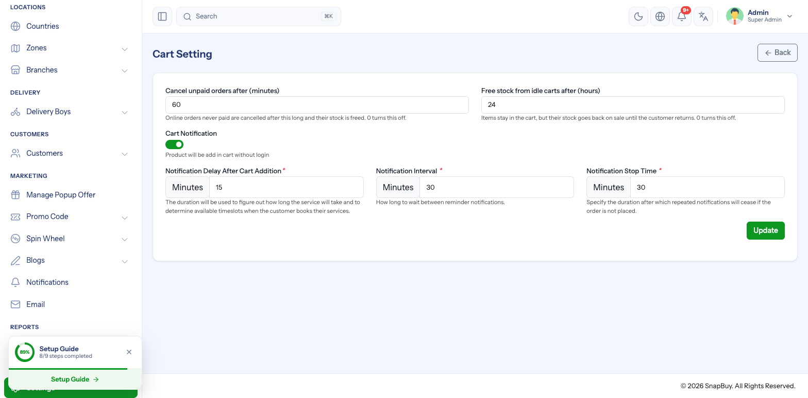

# Cart Settings

Menu path: **Settings → Cart Settings**

Two separate things live on this page: the **push reminders** sent to customers who left something in the cart, and the two **stock-release limits** that stop abandoned carts and unpaid orders holding stock for ever.

## Settings

| Field | Meaning |
| --- | --- |
| **Cancel unpaid orders after (minutes)** | An online order that was never paid is cancelled after this long, and its stock goes back on sale. `0` turns it off. Default **60**. |
| **Free stock from idle carts after (hours)** | Stock held by a cart nobody came back to goes back on sale. The items stay in the cart. `0` turns it off. Default **24**. |
| **Cart Notification** | Master switch |
| **Notification Delay After Cart Addition** | How long to wait after the last item is added before the first reminder |
| **Notification Interval** | Gap between repeat reminders |
| **Notification Stop Time** | When to stop reminding that customer |

The three reminder timings are in minutes.

## Stock that would otherwise be stuck

Stock is reserved the moment it is spoken for, so that two customers cannot buy the last unit. Two things used to hold it indefinitely, and both now time out.

| Setting | What it releases | What the customer sees |
| --- | --- | --- |
| **Cancel unpaid orders after** | An order that reached *Payment pending* and never got paid | The order is cancelled. Their cart is untouched, so they can try again. A payment that lands later goes to their wallet, as for any cancelled order. |
| **Free stock from idle carts after** | Stock held by cart lines nobody has touched | **Nothing changes in their cart.** The items are still there; the stock is simply back on sale until they check out. |

:::warning These are the numbers that decide whether you oversell or undersell
Too long, and a sell-out product sits unavailable because of carts that will never check out. Too short, and a customer who takes their time at a slow payment page finds the item gone at the last step. `60` minutes and `24` hours suit most stores; a flash sale may want both much lower.
:::

:::info Both need the cron job
They are run by `orders:expire-unpaid` (every five minutes) and `cart:release-idle-stock` (every ten minutes). Without the [cron job](/docs/admin/cron-jobs) neither ever runs, and stock stays held.
:::

## How the sequence runs

1. A customer adds something to the cart and does not check out.
2. After the **delay**, the first reminder is sent.
3. Every **interval** after that, another reminder is sent.
4. Once **stop time** is reached, reminders for that cart end.
5. Checking out — or emptying the cart — stops them immediately.

**Example** — delay `60`, interval `1440`, stop `4320`:

| Time after last cart change | What happens |
| --- | --- |
| 1 hour | First reminder |
| 1 day | Second reminder |
| 2 days | Third reminder |
| 3 days | Stops |

:::danger Cart reminders do not work without the cron job
Reminders are sent by `cart:notification`, run by the scheduler every minute. **If the [cron job](/docs/admin/cron-jobs) is not set up, no reminder is ever sent** — and the panel gives no indication anything is wrong.

Check **Settings → Cron Jobs** shows a green heartbeat before you spend time tuning the timings here.
:::

## Choosing timings

:::warning Aggressive reminders get your app muted
Push notifications are easy to turn off and hard to get back. A customer reminded every hour will disable notifications for your app permanently — costing you order updates and delivery alerts too, not just marketing.

Sane starting point: first reminder after **1 hour**, repeat **once a day**, stop after **3 days**.
:::

:::tip Notification stop time is not optional
Leaving the stop time unset or very high means a customer who abandoned a cart months ago keeps getting reminders. Always set a limit.
:::

## What the reminder says

The wording comes from the notification templates:

| Template | When |
| --- | --- |
| `cart_reminder_first_customer` | The first reminder |
| `cart_reminder_interval_customer` | Every repeat |

Edit them under [Notification Templates](/docs/admin/notification-templates), including per-language versions.

:::tip Make the first reminder useful, not naggy
Mention the actual product, or note that stock is limited. "You left something behind" performs far worse than naming what it was.
:::

## Prerequisites

| Requirement | Why |
| --- | --- |
| [Cron job](/docs/admin/cron-jobs) running | Nothing sends without it |
| [Firebase](/docs/admin/firebase-settings) configured | Reminders are push notifications |
| Customer has the app and granted permission | No push token, no reminder |
| Templates written for each active language | Otherwise customers get the default language |

## Troubleshooting

| Symptom | Cause | Fix |
| --- | --- | --- |
| No reminders at all | Cron job missing | See [Cron Job Setup](/docs/admin/cron-jobs) |
| Cron fine, still nothing | Firebase not configured, or master switch off | Check [Firebase](/docs/admin/firebase-settings); enable the switch |
| Reminders too frequent | Interval too short | Raise it — a day is usually right |
| Reminders never stop | Stop time unset or too high | Set a realistic limit |
| Sent after the customer ordered | Timings extremely short, race with checkout | Raise the initial delay |
| Wrong language | Template not translated | Add translations |
