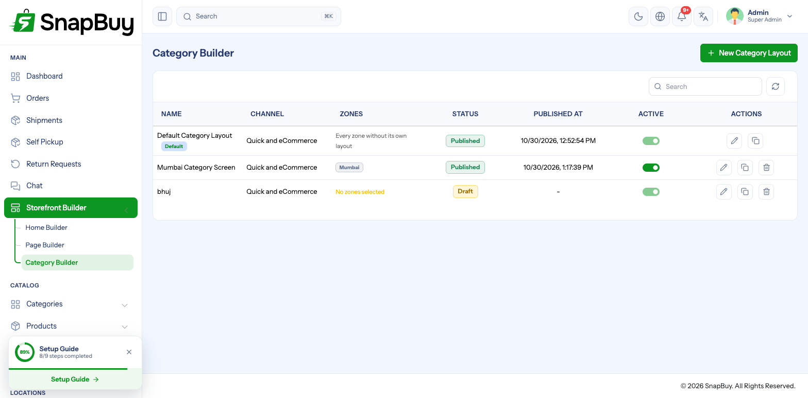
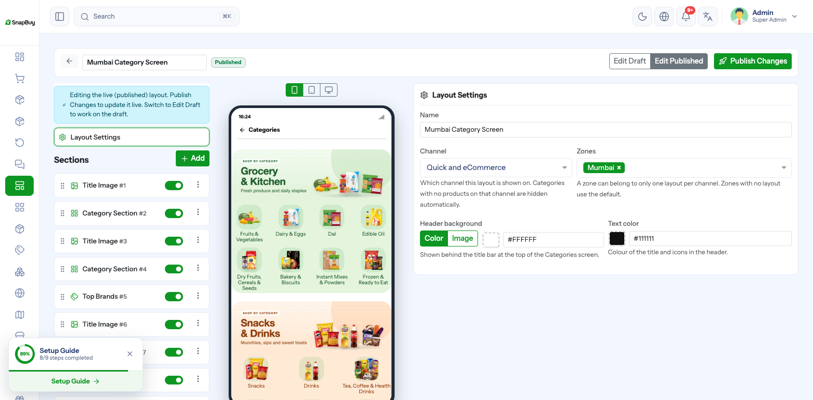
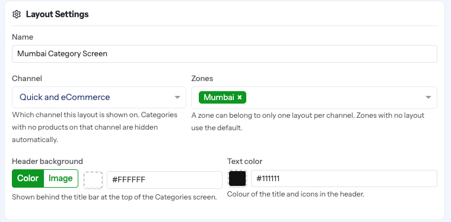

# Category Builder

Menu path: **Storefront Builder → Category Builder**

The **Categories** screen of the app and website is no longer a fixed grid. You design it here, with the same sections you already use in [Home Builder](/docs/admin/home-builder) — category grids, banners, product sliders, brands, headings — and you can give different zones and channels different Categories screens.

:::info Three builders, one toolbox
**Home Builder** designs the home screen, **Category Builder** the Categories screen, **[Page Builder](/docs/admin/page-builder)** standalone pages. They share the same section types, the same image and translation handling, and the same draft/published safety.
:::

## The layout list

| Column | What it shows |
| --- | --- |
| **Name** | Your internal label. The **Default** badge marks the fallback layout. |
| **Channel** | `Quick`, `eCommerce`, or both |
| **Zones** | Which zones this layout serves. The default layout reads *every zone without its own layout*; a layout with none selected is flagged in orange, because it serves nobody. |
| **Status** | `Draft` or `Published` |
| **Published at** | When it last went live |
| **Active** | Inactive layouts are never served |
| **Actions** | Edit, clone, delete |

Clone is the fast way to build a second layout: copy the one that works, change the zone and the banners.

:::danger The default layout cannot be deleted or deactivated
It is what a customer gets when no other layout matches their zone and channel, so the Categories screen is never empty for a deliverable location. Only published layouts can be made active.
:::

## Which layout a customer gets

1. The app sends the customer's location and channel — never a layout id.
2. SnapBuy finds their zone, then the **active, published** layout assigned to that zone and channel.
3. If none is assigned, the **default** layout is served.
4. Outside every zone, the customer gets the usual "we do not deliver here" screen.

So a customer in Mumbai on quick commerce can see a different Categories screen from a customer in Pune, or from the same customer browsing eCommerce.

## Building a layout

The editor is the Home Builder editor: sections on the left, the section you are editing in the middle, a live device preview on the right.

| Control | What it does |
| --- | --- |
| **Add** | Adds a section — the same section types as Home Builder |
| **Drag handle** | Reorders sections; the order here is the order customers see |
| **Section switch** | Turns a section off without deleting it |
| **Clone / Delete** | On each section's menu |
| **Use template / Save as template** | Reuses a section you built elsewhere |
| **Platform toggles** | Show a section on app, tablet or web only |
| **Edit draft / Edit published** | Which copy you are changing |
| **Save draft** | Saves without affecting customers |
| **Publish** | Makes the draft what customers see |

### Layout settings

Open **Layout settings** above the section list.

| Field | What it does |
| --- | --- |
| **Name** | Internal label |
| **Channel** | `Quick and eCommerce`, `Quick` or `eCommerce` — which channel this layout is shown on |
| **Zones** | The zones it serves. **A zone can belong to only one layout per channel.** Leave empty on anything but the default layout and it serves nobody. |
| **Header background** | `Color` or `Image` for the top bar of the Categories screen |
| **Background image** | One image each for **app**, **tablet** and **web**. Tablet and web fall back to the app image when left empty. |
| **Text colour** | Colour of the screen title and the icons on that bar |

:::tip The header is the part Home Builder does not have
Everything else in this editor behaves exactly as it does on the home screen. The header is the Categories screen's own top bar — set it to a flat colour for a clean look, or to an image for a seasonal campaign, and set the text colour so the title stays readable on top of it.
:::

### Empty categories are dropped for you

A category grid never shows a category that has nothing to sell in that customer's zone and channel. Food categories, for example, show on quick commerce and not on eCommerce.

A section left with nothing to show is removed from the screen altogether, so a layout can look shorter in the app than it does in the editor. That is correct behaviour, not a missing section.

## Draft and published

Identical to Home Builder:

| Copy | What it is |
| --- | --- |
| **Draft** | What you are editing. Never visible to customers. |
| **Published** | What customers see right now. |

**Save draft** is safe at any time. Nothing reaches customers until you press **Publish**.

## Permissions

Category Builder has its own permissions — list, create, update and delete — under [Roles & Permissions](/docs/admin/roles-permissions). A staff role can be allowed to edit layouts without touching anything else in the panel.

## Troubleshooting

| Symptom | Cause | Fix |
| --- | --- | --- |
| Categories screen looks nothing like the editor | The layout is still a draft | Press **Publish** |
| A zone gets the wrong Categories screen | No layout assigned to that zone, so the default is served | Assign the zone on the layout's settings |
| Layout saved but nobody sees it | It is inactive, or has no zones selected | Publish it, turn **Active** on, select its zones |
| Sections missing in the app | Those categories have no products in that zone or channel | List products at a branch in that zone, or expect the section to stay hidden |
| Cannot delete a layout | It is the default | Make another layout the one you edit; the default stays |
| Changes appear on app but not web | The section is limited by its platform toggles | Turn the web platform on for that section |

## Checklist

- [ ] Default layout reviewed — it is what unassigned zones get
- [ ] Each extra layout has its channel and zones set
- [ ] Header background and text colour readable on a real device
- [ ] Sections checked on app, tablet and web previews
- [ ] Layout published **and** active
- [ ] Opened the Categories screen in the customer app once
