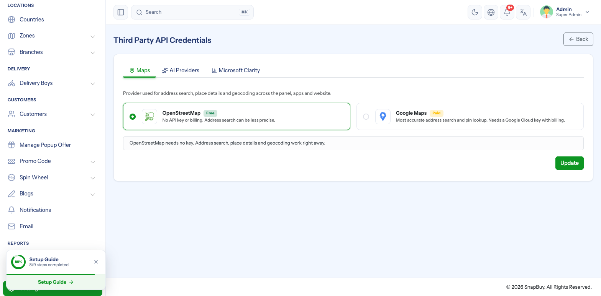
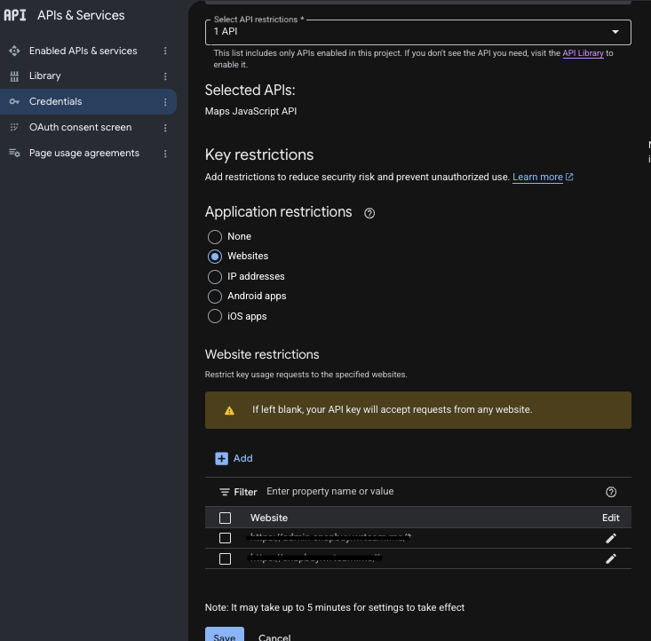
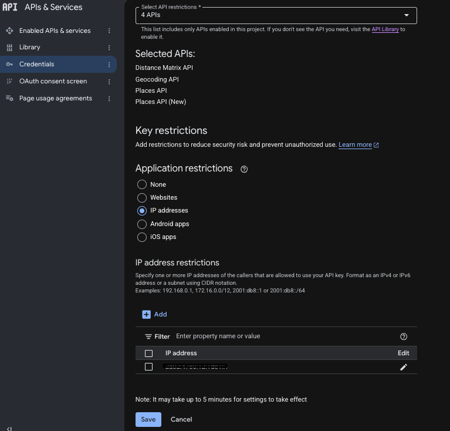

# Map & API Keys

**Setup Guide step 7 of 9.** Menu path: **Settings → API Credentials**

Maps do real work in SnapBuy, not decoration:

- Customers pick their delivery address on a map
- You draw [zone](/docs/admin/zones) polygons on a map
- You drop the [branch](/docs/admin/branches) pin on a map
- **Road distance between branch and customer sets the quick-channel delivery charge**



The page has three tabs:

| Tab | What it holds |
| --- | --- |
| **Maps** | Map provider, and the Google keys below |
| **AI** | The AI service that writes content for you — see [AI Settings](/docs/admin/ai-settings) |
| **Microsoft Clarity** | Optional session-analytics project ids, one per app |

## Choose a provider

| Provider | Cost | Address autocomplete | Setup |
| --- | --- | --- | --- |
| **OpenStreetMap** | Free | Basic | None — works immediately |
| **Google Maps** | Paid, with a monthly free credit | Excellent | Two API keys, billing enabled |

Pick one of the two provider cards at the top of the **Maps** tab. SnapBuy defaults to **OpenStreetMap**, and distance is measured with the public OSRM routing service. Choosing OpenStreetMap hides the key fields altogether, because it needs none.

:::tip Start on OpenStreetMap
It needs no keys, no billing and no Google account, and the Setup Guide's Map step completes the moment you select it. Switch to Google later if address search quality becomes a problem.
:::

:::warning OpenStreetMap uses a shared public routing service
Distance lookups go to the public OSRM demo server. It is free and unauthenticated, but it is rate-limited and offers no uptime guarantee. On a branch doing serious order volume, move to Google Maps or host your own OSRM instance — otherwise busy periods can produce "unable to fetch distance" at checkout.
:::

## Using Google Maps

Google needs **two separate keys**. This trips people up constantly.

| SnapBuy field | Google API | Used for |
| --- | --- | --- |
| **Map API Key** | Maps JavaScript API | Rendering the map tiles you see when drawing zones and pinning branches |
| **Place API Key** | Places API (New), Geocoding API, Routes API | Address search, autocomplete, and measuring the branch-to-customer distance that sets the quick-channel delivery charge |

:::danger Distance comes from the Routes API now, and it uses the Place key
SnapBuy measures the branch-to-customer road distance with the **Routes API** (`computeRouteMatrix`), sent with the **Place API Key**. The old Distance Matrix API is no longer called at all.

Enabling Routes against the Map key only — or restricting the Place key to Places and Geocoding — leaves the map working perfectly while every delivery-charge lookup fails.

The symptom is "unable to fetch distance" at checkout on a panel where the maps clearly render fine.
:::

:::danger Both keys are required
The Setup Guide marks the Map step complete only when **both** the Map key and the Place key are filled. Entering one leaves the step red — and address autocomplete or distance calculation will be broken depending on which is missing.
:::

### Create the keys

1. Open [console.cloud.google.com](https://console.cloud.google.com/).
2. Create a project, or select one.
3. **Enable billing** — Google refuses Maps requests without a billing account, even inside the free credit.
4. Go to **APIs & Services → Library** and enable:
   - Maps JavaScript API
   - Places API (New)
   - Geocoding API
   - Routes API
5. Go to **APIs & Services → Credentials → Create credentials → API key**.
6. Create **two** keys and name them clearly.
7. Paste them into the **Maps** tab and press **Test Place API Key** — it calls Places and Geocoding with the key you just entered and reports each one separately, so a key that is missing one API shows up here instead of at a customer's checkout.

Each key field has a show/hide eye, so a saved key can be checked without being left on screen.

Those four are everything SnapBuy needs. It calls Google's **current** endpoints only — `places.googleapis.com/v1` for address search and `routes.googleapis.com` for distance — so the legacy services are **not** required:

| Legacy service | Replaced by | Still needed? |
| --- | --- | --- |
| Places API (the original one) | Places API (New) | No |
| Distance Matrix API | Routes API | No |
| Directions API | Routes API | No |

Places API and Places API (New) are listed as two separate services in the Library. Enable only **Places API (New)** — recent Google Cloud projects do not even offer the old one.

:::warning Upgrading an existing SnapBuy? Enable Routes API
Earlier SnapBuy versions called Distance Matrix and the legacy Places endpoints. This version does not. If your Google project was set up for the old pair, go to **APIs & Services → Library**, enable **Routes API** and **Places API (New)**, then add both to the Place key's API restrictions — otherwise delivery-charge lookups and address search stop working after the update, on a project that was perfectly correct before.

The legacy services can be left enabled; they are simply never called. Turning them off is tidier and changes nothing.
:::

:::danger Billing must be enabled
Without a billing account every Google Maps request fails and the map area renders grey with a "for development purposes only" watermark. Google applies a recurring monthly credit that covers small shops, but the account must still exist.
:::

### Restrict the keys

An unrestricted Maps key found in your page source can be used by anyone, billed to you.

The two keys are restricted differently, because they are called from different places:

| Key | Called from | Application restriction |
| --- | --- | --- |
| **Map API Key** | The visitor's browser | **Websites (HTTP referrers)** — your domain |
| **Place API Key** | Your server | **IP addresses** — your server's IP |

#### Map API Key — restrict by domain

This key is loaded into the page, so anyone can read it. Restricting it by referrer means it only works when requested from your own site.

In **APIs & Services → Credentials**, open the key and under **Application restrictions** choose **Websites**, then add:

```
https://admin.yourstore.com/*
https://yourstore.com/*
```



#### Place API Key — restrict by IP address

SnapBuy calls Places (New), Geocoding and Routes **from the server**, not the browser. A referrer restriction would block those calls, because a server-to-server request sends no referrer.

Restrict this key by **IP addresses** instead and enter your server's address. Modern VPS providers usually assign an **IPv6** address, so add that — and the IPv4 address too if your server has one.

In **APIs & Services → Credentials**, open the key, choose **IP addresses** under **Application restrictions**, and add:

```
2400:xxxx:xxxx:xxxx::1
203.0.113.10
```



Under **API restrictions**, limit it to **Places API (New)**, **Geocoding API** and **Routes API**.

:::danger Do not restrict the Place key by referrer
It is the most common way to break delivery-charge calculation. Server-side requests carry no referrer, so the key is rejected — the map still draws, because that uses the other key, and the failure looks like a distance problem rather than a key problem.
:::

:::tip Find your server's IP
Run this on the server:

```bash
curl -6 ifconfig.co   # IPv6
curl -4 ifconfig.co   # IPv4
```

If your server's IP changes, the key stops working until you update the restriction. Static addressing is worth having here.
:::

:::warning Restrict, but test afterwards
Over-restricting is the second most common Maps problem. After adding restrictions, reload the panel and confirm the zone map still draws — **then place a test order to an address a few kilometres from the branch** and check the delivery charge is calculated. The map drawing correctly does not prove the Place key can still reach the Routes API.

Restriction changes can take a few minutes to take effect.
:::

### Set a budget alert

In **Billing → Budgets & alerts**, create a budget with email alerts. It will not stop charges, but you find out about a spike in hours rather than at the end of the month.

## AI content generation

The **AI** tab of this page is where you connect an AI service — OpenAI, Anthropic, Gemini, Groq, DeepSeek, Mistral, OpenRouter and others — and pick the model that writes product descriptions, SEO, blog posts and translations for you.

It has nothing to do with maps and is entirely optional. See [AI Settings](/docs/admin/ai-settings) for the whole of it.

:::info Where the old Gemini key went
The single **Gemini Key** field this page used to carry is now Gemini's row on the AI tab, with a model picker beside it. Your existing key is carried over automatically.
:::

## Troubleshooting

| Symptom | Cause | Fix |
| --- | --- | --- |
| Setup Guide Map step stays red | Provider is Google but only one key filled | Fill both Map and Place keys |
| Grey map with a watermark | Billing not enabled on the Google project | Enable billing |
| "This page can't load Google Maps correctly" | Required API not enabled, or the Map key's domain restriction does not cover this hostname | Enable the APIs; add the hostname to the Map key's website restrictions |
| Map loads, address search does nothing | **Places API (New)** not enabled, or Place key missing | Enable Places API (New); fill the Place key |
| "Unable to fetch distance" at checkout, but maps render fine | **Routes API** not enabled, or the Place key is restricted by referrer instead of by server IP | Enable Routes API; restrict the Place key by IP address |
| Distance and address search worked before the update, not after | The project has only the legacy Distance Matrix and Places APIs enabled | Enable **Routes API** and **Places API (New)**, and allow both on the Place key |
| "Unable to fetch distance" on OpenStreetMap | Public OSRM routing service rate-limited | Switch to Google Maps, or host your own OSRM |
| Distance lookups failed after a server migration | Place key still restricted to the old server IP | Update the IP restriction |
| Unexpected Google bill | Unrestricted key in use elsewhere | Apply the restrictions above and regenerate the key |
| AI buttons missing or failing | Set up on the **AI** tab, not here | See [AI Settings](/docs/admin/ai-settings) |

## Checklist

- [ ] Provider chosen
- [ ] If Google: billing enabled, all four APIs enabled — Maps JavaScript, Places API (New), Geocoding, Routes
- [ ] If Google: **both** Map and Place keys entered
- [ ] Routes API enabled and allowed on the Place API Key
- [ ] Map key restricted by domain; Place key restricted by server IP
- [ ] Budget alert configured
- [ ] Zone map draws correctly
- [ ] Test address returns a sensible delivery charge
- [ ] If using AI generation: a provider set up on the **AI** tab — see [AI Settings](/docs/admin/ai-settings)
