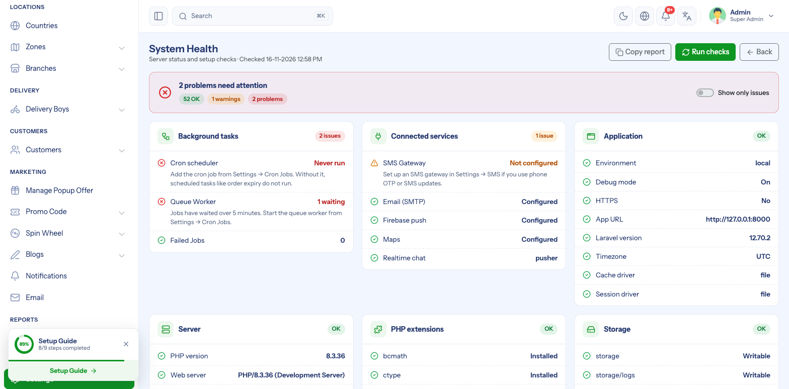

# System Health

Menu path: **Settings → Advanced → System Health**

One page that answers "is this server set up correctly, and is everything still running?" It checks the application, the background tasks, your third-party services, the server itself, PHP, storage and the database, and marks every result **OK**, **warning** or **problem**.

:::info It only reads; it never changes anything
Nothing on this page edits a setting, restarts a service or touches a file. It is safe to run at any time, as often as you like.
:::

## Reading the page

| Control | What it does |
| --- | --- |
| **Summary banner** | A one-line verdict — *all checks passed*, or how many problems need attention — with pills counting OK, warnings and problems |
| **Show only issues** | Hides every passing check, so you see just what needs attention |
| **Run checks** | Runs everything again — the figures are live, not cached |
| **Copy report** | Copies the whole result as text, ready to paste into a support ticket |
| **Checked at** | When the results on screen were produced |

Checks are grouped into cards — Background tasks, Connected services, Application, Server, PHP extensions, Storage, Database — and **the cards with issues are shown first**, each with its own *OK* or *2 issues* badge.

Every failing check carries a **hint** in plain words saying what to do about it. A passing check shows no hint, because there is nothing to do.

| Status | Means |
| --- | --- |
| **OK** | Nothing to do |
| **Warning** | It works, but something is missing, unset or slower than it should be |
| **Problem** | Something is broken or unsafe, and customers are probably affected |

## What is checked

### Application

| Check | Flagged when |
| --- | --- |
| **Environment** | `APP_ENV` is neither `production` nor a local setup |
| **Debug mode** | `APP_DEBUG=true` on a live site — a **problem**, because error pages then show file paths and secrets to visitors |
| **HTTPS** | The site is not served over HTTPS. Logins and payments need it. |
| **App URL** | `APP_URL` does not match the address the panel is actually open on — the usual cause of broken images and wrong links in emails |
| **Laravel version, timezone, cache driver, session driver** | Information only |

### Background tasks

| Check | Flagged when |
| --- | --- |
| **Cron scheduler** | The heartbeat is more than ~2½ minutes old. Means the [cron job](/docs/admin/cron-jobs) is not running, so nothing scheduled happens — no cart reminders, no unpaid-order cancellation, no scheduled publishing. |
| **Queue worker** | Jobs are waiting and the oldest has sat there over 5 minutes, so the [worker](/docs/admin/cron-jobs#the-queue-worker) is not running. A `sync` queue driver shows as a warning. |
| **Failed jobs** | Anything is in the failed-jobs table. Look in [System Logs](/docs/admin/system-logs) for why. |

:::danger These two are the ones to look at first
Most "notifications stopped", "emails never arrive" and "orders stay pending" reports are one of these two lines showing red. Check them before anything else.
:::

### Connected services

Whether each thing SnapBuy can use is configured at all: **SMTP**, **SMS gateway**, **Firebase push**, **Maps**, and **real-time chat**. Not configured is a warning, not a failure — a store that does not use SMS is fine with that line amber.

### Server

| Check | Wants |
| --- | --- |
| **PHP version** | 8.3 or newer — below that is a **problem** |
| **Memory limit** | 256 MB or more |
| **Max execution time** | 60 seconds or more |
| **Max upload size** | 8 MB or more |
| **Max post size** | At least as large as the upload size, or big uploads fail silently |
| **OPcache** | On — off is a warning, because pages are much slower without it |
| **Web server, OS** | Information only |

See [PHP INI Settings](/docs/admin/php-ini-settings) for how to change these.

### PHP extensions

The thirteen SnapBuy requires — `bcmath`, `ctype`, `curl`, `dom`, `fileinfo`, `gd`, `json`, `mbstring`, `openssl`, `pdo_mysql`, `tokenizer`, `xml`, `zip` — each marked installed or **missing**. A missing one is a problem: ask your host to enable it.

Four more are listed as **optional** — `intl`, `exif`, `imagick`, `redis`. They are never marked as faults.

### Storage

| Check | Flagged when |
| --- | --- |
| **Writable folders** | `storage`, `storage/logs`, `storage/app/public`, `storage/app/private` or `bootstrap/cache` is not writable — the panel cannot save uploads or write logs |
| **Storage link** | `public/storage` is missing, so uploaded images do not load. Run `php artisan storage:link`. |
| **Free disk space** | Under 15% free is a warning, under 5% a problem |
| **Log files size / Uploads size / Database backups size** | Information — the three things that quietly fill a disk |

### Database

Connection, server version, database size and table count, and **pending migrations**. Anything other than `0` pending is a problem: the code expects tables the database does not have yet. See [Database & Migrations](/docs/installation/database-migration).

## When to use it

- **Right after installing**, before you start entering real data
- **After moving to another server**, where paths, permissions and PHP versions all change
- **After a [system update](/docs/admin/system-updater)**, to confirm migrations ran
- **Before contacting support** — **Copy report** and paste it into the ticket; it answers most of the first questions

## Troubleshooting

| What you see | What it means | Fix |
| --- | --- | --- |
| Cron scheduler red | The cron entry is missing or not firing | [Cron Job Setup](/docs/admin/cron-jobs) |
| Queue worker red | The worker is not running, jobs are piling up | [The queue worker](/docs/admin/cron-jobs#the-queue-worker) |
| Debug mode red | `APP_DEBUG=true` on a live site | Set `APP_DEBUG=false` in `.env` |
| HTTPS red | No SSL, or `APP_URL` still `http://` | [Domain, DNS & SSL](/docs/admin/create-subdomain) |
| App URL amber | `APP_URL` does not match the real address | Correct it in `.env` |
| A folder not writable | Wrong ownership or permissions after a copy or upload | Give the web-server user write access to that folder |
| Storage link red | The symlink was lost — common after a zip-based deployment | `php artisan storage:link` |
| Pending migrations red | The update's database changes have not run | Run the migrations |
| An extension missing | Not enabled in your hosting PHP build | Ask the host to enable it, then re-run the checks |

## Checklist

- [ ] No red checks on a live store
- [ ] Cron scheduler and queue worker both green
- [ ] Debug mode off, HTTPS on, App URL correct
- [ ] Every required PHP extension installed
- [ ] Storage folders writable and the storage link present
- [ ] Free disk space comfortably above 15%
- [ ] Pending migrations `0`
