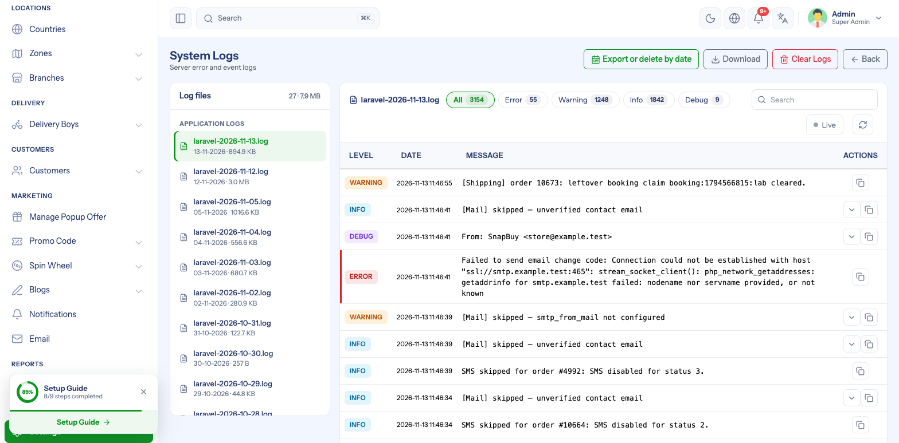

# System Logs

Menu path: **Settings → Advanced → System Logs**

The server's own error and event logs — the files in `storage/logs` — read inside the panel. When something failed and you need the reason rather than the symptom, this is where it is written down.

:::info Not the same as Activity Logs
[Activity Logs](/docs/admin/activity-logs) records **who** did **what** in the panel — a staff audit trail. System Logs records what the **application** hit: failed jobs, rejected webhooks, SMTP errors, exceptions. Different question, different page.
:::

## The file list

Files are listed newest first, with their size and date, under a heading that totals how many files there are and how much disk they take. The one being written today is the one you usually want.

| Kind | Files | Holds |
| --- | --- | --- |
| **Application logs** | `laravel*.log` | Errors and exceptions from the panel, the APIs and background jobs |
| **Webhook logs** | `webhooks*.log` | What payment and courier providers sent you, and what SnapBuy made of it |
| **Other logs** | anything else | Whatever else your server writes there |

Only plain `.log` files sitting directly in `storage/logs` can be opened — nothing outside that folder is reachable from this page.

## Reading a file

| Control | What it does |
| --- | --- |
| **Level chips** | `All`, then every level present in that file — `Error`, `Warning`, `Info`, `Debug` and the rest — each with a count. Click one to show only that level. |
| **Search** | Matches the message and the full details, not just the first line |
| **Details** | Expands one entry to its stack trace or context |
| **Copy** | Copies that entry, ready to paste into a support ticket |
| **Live** | Re-reads the open file every 10 seconds, so you can watch while reproducing a problem |
| **Per page** | Up to 200 entries at a time |

:::tip Reproduce it with Live on
Open the file, turn **Live** on, then trigger the thing that fails — place the test order, send the test email. The entry appears within ten seconds, with the real reason.
:::

:::info Big files are read from the end
Only the newest **4 MB** of a file is parsed, so even a very large log opens quickly. The page says so when that happens, and **Download** always gives you the whole file.
:::

## Secrets are masked

Passwords, API keys, tokens, `Authorization` headers, OTPs, PINs, card numbers and CVVs are replaced with `••••` before a line ever leaves the server — in the viewer, in a single download and in a bulk ZIP alike. Keys in recognisable provider formats (`sk_live_…`, `rzp_…`, `whsec_…`) are masked too.

:::warning Masking is good, not perfect
It catches the usual shapes. Before you post a log into a public forum or ticket, still read what you are pasting — a provider may have written a value in a format nothing can recognise.
:::

## Downloading and clearing

| Button | What it does |
| --- | --- |
| **Download** | The open file in full, masked |
| **Clear logs** | Empties the open file. A past day's dated file is deleted instead, because it will never be written again. |
| **Export or delete by date** | Works across many files at once |

### Export or delete by date

Pick a **date range** — last 7, 30 or 90 days, or your own — and which **log types** to include. The dialog shows how many files and how much disk space that comes to, then:

- **Download ZIP** — every matching file in one archive, each masked
- **Delete** — removes them

:::danger Clearing cannot be undone
There is no copy anywhere else. Download first if there is any chance you will want the file later — especially before clearing a day on which something went wrong.
:::

Today's files are still being written, so they are **emptied** rather than deleted; everything older is removed.

## What to look for

| Problem | Where to look |
| --- | --- |
| Payment taken but the order stayed unpaid | **Webhook logs** — whether the gateway called at all, and what was rejected |
| Emails not arriving | **Application logs**, around the time of the send — SMTP errors are recorded in full |
| Notifications not arriving | **Application logs** — Firebase rejects the send with a reason |
| Background work not happening | **Application logs**, plus the failed-jobs count on [System Health](/docs/admin/system-health) |
| A page in the panel erroring | **Application logs** at `ERROR` level, with the stack trace in **Details** |

## Housekeeping

Log files grow quietly and are a common cause of a full disk. [System Health](/docs/admin/system-health) shows their total size under **Storage**; use **Export or delete by date** to clear anything older than a month or two once you have no open issues.

## Troubleshooting

| Symptom | Cause | Fix |
| --- | --- | --- |
| No log files listed | Nothing has been logged yet, or `storage/logs` is not readable | Check the folder exists and is writable — System Health flags this |
| A file will not clear | The web-server user cannot write to it | Fix the file's ownership or permissions |
| Bulk ZIP fails | The server's PHP has no `zip` extension | Enable `zip`, or download files one at a time |
| Entries look truncated | The file is larger than 4 MB | Use **Download** for the whole thing |
| The log is enormous | Nothing clears it automatically | Delete by date, and fix whatever is erroring repeatedly |

## Checklist

- [ ] You know which file is which — application vs webhook
- [ ] Checked the log before escalating a "nothing happens" report
- [ ] Downloaded anything you may need before clearing
- [ ] Log folder size reviewed on System Health
