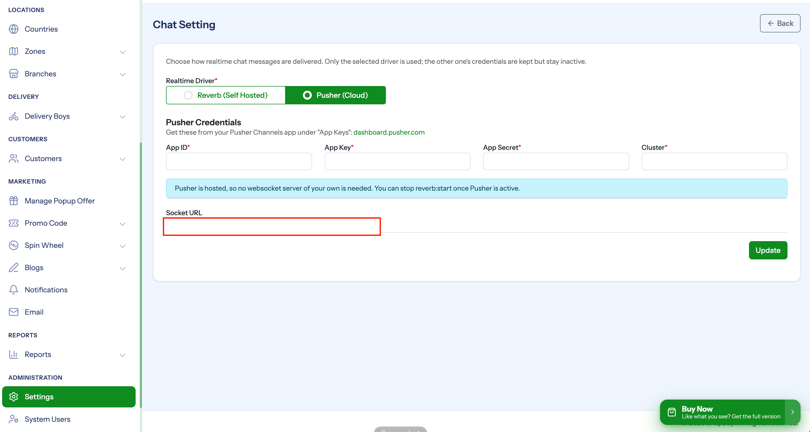

# Socket URL Setup (Chat)

Real-time chat in the Customer app connects to a WebSocket server. The app finds that server through one config key: `SOCKET_BASE_URL`. If it is wrong or empty, messages only show after a refresh, or chat never connects.

The URL comes from the admin panel. Copy it from there, paste it into the app, rebuild.

## Step 1 — Get the Socket URL from the panel

1. Open admin panel → **Settings → Chat Settings**.
2. Pick the **Realtime Driver** (Reverb or Pusher) and fill its credentials. See [Chat Settings](/docs/admin/chat-settings).
3. Click **Update**.
4. Copy the value in the **Socket URL** field (red box below).



:::info Only the selected driver is used
The other driver's credentials stay saved but inactive. Switch driver in the panel → Socket URL changes → update the app too.
:::

## Step 2 — Know the URL format

| Driver | Socket URL format | Example |
|--------|-------------------|---------|
| **Reverb** (self-hosted) | `wss://<your-domain>:<port>/app/<APP_KEY>` | `wss://admin.example.com:8080/app/w73uw1egonunwexdhebg` |
| **Pusher** (cloud) | `wss://ws-<cluster>.pusher.com/app/<APP_KEY>` | `wss://ws-ap2.pusher.com/app/a1b2c3d4e5f6g7h8i9` |

- Use `wss://` (secure) for any HTTPS panel. Plain `ws://` is blocked on HTTPS and on iOS by default.
- `<APP_KEY>` = **App Key** from Chat Settings. Not App Secret. Never put the secret in the app.
- Port and domain must match **Host / Port / Scheme** in Chat Settings.

## Step 3 — Paste into the app

Open `env/demo.json` (or your active environment file) and set `SOCKET_BASE_URL`:

```json
{
  "BASE_URL": "https://admin.example.com/customer/",
  "SOCKET_BASE_URL": "wss://admin.example.com:8080/app/YOUR_APP_KEY"
}
```

Then sync and rebuild:

```bash
dart run tool/apply_config.dart
flutter clean && flutter run
```

:::tip
Full environment explanation (`dev` / `stage` / `demo`) is in the [Panel URL & Deeplink Setup](/docs/app-customer/panel-url-deeplink) page (Customer App).
:::

## Step 4 — Verify

1. Make sure the socket server is running. Reverb: `php artisan reverb:start` (Supervisor in production). Pusher: nothing to run.
2. Open the Customer app and a chat on an order.
3. Send a message from the panel or the other app.
4. It should appear **instantly, no refresh**.

## Troubleshooting

| Symptom | Cause | Fix |
|---------|-------|-----|
| Chat never connects | `SOCKET_BASE_URL` empty or has typo | Re-copy from panel Socket URL field |
| Messages only after refresh | Reverb process down, or wrong port | Start Reverb, open port, match port in URL |
| Works on Android debug, fails release | `ws://` used on HTTPS | Use `wss://` and proxy through Nginx |
| Pusher connects then drops | Wrong cluster in URL | Match `ws-<cluster>` with panel Cluster |
| Stopped after switching driver | App still has old driver URL | Copy new Socket URL, rebuild app |
| Changed URL, no effect | Config not synced / old build | Run sync script, then `flutter clean` |

## Checklist

- [ ] Chat Settings saved in the panel
- [ ] Socket URL copied from the panel
- [ ] `wss://` used for HTTPS
- [ ] App Key (not Secret) in the URL
- [ ] Sync script run and app rebuilt
- [ ] Live message tested without refresh
